# Chapter 1 — A Tour of Computer Systems

## Key Takeaways

- A computer system = [[hardware]] + systems software cooperating to run programs — understanding both layers pays off in performance, debugging, and security.
- All information is bits; **context**, not the bits themselves, determines whether a sequence means an int, a float, a string, or an instruction ([[information is bits and context]]).
- Source → executable goes through 4 phases: **preprocess → compile → assemble → link** — collectively the [[compilation system]].
- The CPU just loops: fetch the instruction at the [[program counter]], decode it, do one of {Load, Store, Operate, Jump}, update the PC.
- The processor–memory speed gap is why systems use a [[memory hierarchy]] (registers → L1 → L2 → L3 → RAM → disk → network storage) — exploiting **locality** is one of the biggest performance levers available to a programmer.
- The [[operating system]] provides three core abstractions: **processes** (CPU+memory+I/O), **virtual memory** (RAM+disk), **files** (I/O devices).
- **Concurrency ≠ parallelism**: concurrency = multiple simultaneous activities; parallelism = _using_ concurrency to go faster (thread-level, instruction-level, SIMD).
- [[Amdahl's Law]]: speeding up only part of a system gives diminishing overall returns — `S = 1 / [(1-α) + α/k]`. To get a big system-wide speedup you must improve a _large fraction_ of the system.
- A network is architecturally "just another I/O device" — copying bytes to/from a network adapter is conceptually the same as copying to/from disk.

---

## 1.1 Information Is Bits + Context

- `hello.c` starts life as a **source file**: a sequence of [[byte]]s (8-bit chunks), each encoding a character via [[ASCII]].
- Files made entirely of ASCII characters = **text files**; everything else = **binary files**.
- Core idea: _all_ information in a system (disk files, in-memory programs, network data) is just bits. The only thing that distinguishes an int from a float from a string from a machine instruction is the **context** in which it's interpreted.

```c
// code/intro/hello.c — the running example for the whole chapter
#include <stdio.h>

int main()
{
    printf("hello, world\n");
    return 0;
}
```

---

## 1.2 Programs Are Translated by Other Programs into Different Forms

A C program can't run as text — it must be translated into low-level machine instructions and packaged as an **executable object file**. On Unix this is done by the **compiler driver** (`gcc`), which runs four programs in sequence — together known as the [[compilation system]]:

- **Preprocessor** (`cpp`) — expands `#include`/`#define` directives → `hello.i` (still text)
- **Compiler** (`cc1`) — translates C → [[assembly language]] → `hello.s` (still text)
- **Assembler** (`as`) — translates assembly → machine instructions, packaged as a **relocatable object file** → `hello.o` (binary)
- **Linker** (`ld`) — merges `hello.o` with precompiled library object files (e.g. `printf.o`) → the final **executable object file** `hello`

**Diagram — the compilation pipeline:**

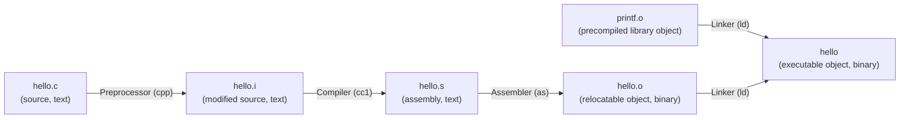

- Assembly is useful as a **common output language**: different front-ends (C, Fortran, …) can all target the same assembler.
- `gcc`'s output for `main` on x86-64 is illustrative of how a `printf` call with a plain string (no format specifiers) often gets folded into a cheaper `puts` call by the compiler.

**🧪 Try it — Compiler Explorer (godbolt.org):**

- Language: **C** · Compiler: **x86-64 gcc** (any recent version) · Flags: `-O0 -m64`
- Paste the `hello.c` snippet above and inspect the generated assembly for `main` — look for `call puts` instead of `call printf`.

**🧪 Try it — locally, to see every phase as a real file:**

```bash
gcc -E hello.c -o hello.i   # preprocessing only
gcc -S hello.i -o hello.s   # compile to assembly
gcc -c hello.s -o hello.o   # assemble to relocatable object
gcc hello.o -o hello        # link into executable
./hello
```

---

## 1.3 It Pays to Understand How Compilation Systems Work

Three practical reasons to care about what the compiler does:

- **Optimizing performance** — e.g. is `switch` faster than `if/else`? How expensive is a function call? Is summing into a local faster than into a by-reference argument? → covered later via [[x86-64]] machine code (Ch.3) and memory-system behavior (Ch.6).
- **Understanding link-time errors** — unresolved references, static vs. global variables, static vs. dynamic libraries, library ordering on the command line → [[linker]] (Ch.7).
- **Avoiding security holes** — most classically, [[buffer overflow]] vulnerabilities, which come from not restricting the size/form of untrusted input relative to how the stack is laid out (Ch.3).

---

## 1.4 Processors Read and Interpret Instructions Stored in Memory

### 1.4.1 Hardware Organization of a System

- **Buses** carry fixed-size chunks of bytes ([[word size]]) between components — typically 4 bytes (32-bit) or 8 bytes (64-bit) on modern machines.
- **I/O devices** (keyboard, mouse, display, disk) connect to the I/O bus via a **controller** (chipset on the device/motherboard) or an **adapter** (a plug-in card).
- **Main memory** is temporary storage (DRAM) holding the running program and its data — logically a linear byte array, addressed from 0.

**Data type sizes, x86-64 Linux:**

|Type|Size|
|---|---|
|`short`|2 bytes|
|`int`, `float`|4 bytes|
|`long`, `double`|8 bytes|

**🧪 Try it — verify the table yourself (Compiler Explorer or locally):**

- Language: **C** · Compiler: **x86-64 gcc** · Flags: `-O0 -m64`

```c
#include <stdio.h>

int main(void) {
    printf("sizeof(short)  = %zu bytes\n", sizeof(short));
    printf("sizeof(int)    = %zu bytes\n", sizeof(int));
    printf("sizeof(float)  = %zu bytes\n", sizeof(float));
    printf("sizeof(long)   = %zu bytes\n", sizeof(long));
    printf("sizeof(double) = %zu bytes\n", sizeof(double));
    return 0;
}
```

- The **[[processor]]** (CPU) is the engine that executes instructions in main memory. Its core storage device is the **[[program counter]]** (PC), which always points at the next instruction to execute.
- The **[[register file]]** is a small set of word-size, named storage locations; the **[[ALU]]** (arithmetic/logic unit) computes new data and address values.
- Only a handful of primitive operations exist: **Load** (memory → register), **Store** (register → memory), **Operate** (registers → ALU → register), **Jump** (extract a word from the instruction → overwrite PC).
- **[[instruction set architecture]]** (ISA) = the simple, sequential model the processor _appears_ to follow; **[[microarchitecture]]** = how it's _actually_ implemented (often far more complex, e.g. executing multiple instructions in parallel).

**Diagram — hardware organization of a typical system:**

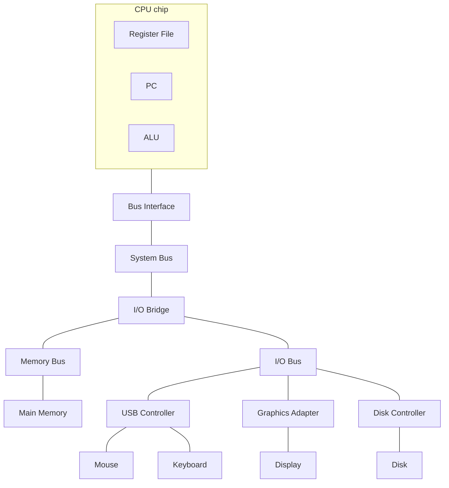

**Diagram — the fetch/execute cycle:**

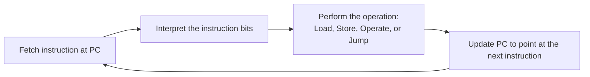

### 1.4.2 Running the hello Program

Sequence when you type `./hello` and hit Enter:

1. The shell reads each keystroke into a register, then memory.
2. On Enter, the shell loads the executable — code + data copied **disk → main memory** via **DMA** (direct memory access), bypassing the processor entirely.
3. The CPU executes `hello`'s instructions, copying the `"hello, world\n"` string from memory → registers → the display device.

**Diagram — running `./hello`:**

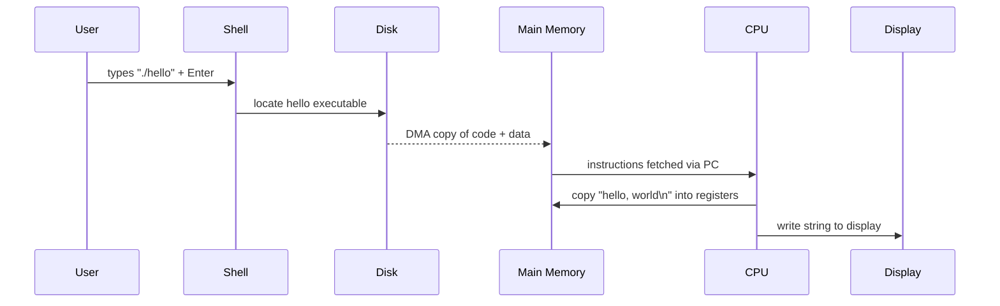

---

## 1.5 Caches Matter

- A system spends a huge amount of time just **moving bytes around** (disk → memory → CPU → display); a major design goal is making those copies fast.
- Physical law: bigger storage = slower storage. A disk might be ~1000× the capacity of main memory but ~10,000,000× slower to read from than memory.
- **Cache memories** (built from **SRAM**) sit between the CPU and main memory as fast staging areas:
    - **L1 cache**: tens of KB, nearly as fast as the register file.
    - **L2 cache**: hundreds of KB–a few MB, ~5× slower than L1 but still 5–10× faster than main memory.
    - Many modern systems add an **L3 cache** too.
- The payoff comes from **locality** — programs tend to reuse recently accessed data/code — so caches holding "likely to be needed soon" data let programmers get near-register speed _and_ near-memory capacity.
- _(See the [[memory hierarchy]] diagram in §1.6 — caches are just the top few levels of it.)_

---

## 1.6 Storage Devices Form a Hierarchy

The general pattern from §1.5 (small+fast in front of big+slow) repeats at every level of the system. Each level acts as a **cache for the level below it**. Moving down: devices get slower, larger, and cheaper per byte.

**Diagram — the memory hierarchy:**

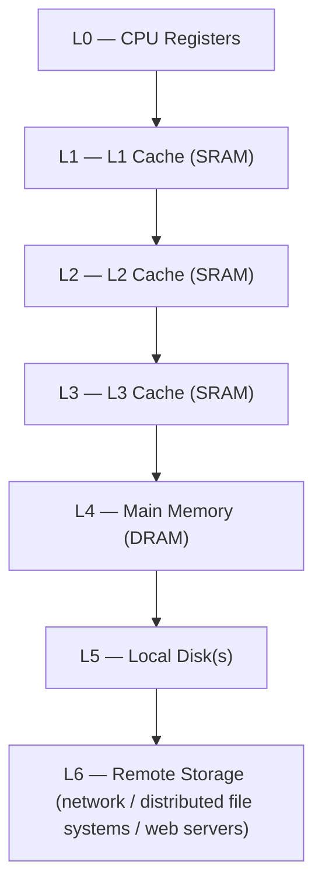

_Top → bottom: smaller, faster, costlier per byte → larger, slower, cheaper per byte._

---

## 1.7 The Operating System Manages the Hardware

Neither the shell nor `hello` touched the keyboard, display, disk, or memory directly — both went through the **[[operating system]]**, a software layer between application and hardware.

Two goals of the OS:

1. **Protect the hardware** from misbehaving applications.
2. Give applications **simple, uniform mechanisms** for very different low-level devices.

It does this via three fundamental abstractions: **processes**, **virtual memory**, **files**.

**Diagram — layered view of a system:**

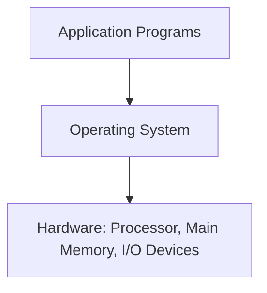

### 1.7.1 Processes

- A **[[process]]** is the OS's abstraction for a running program — it appears to have exclusive use of the CPU, memory, and I/O, even though many processes really run **concurrently** (interleaved) on a small number of CPUs.
- The OS tracks each process's **context**: PC value, register contents, memory contents.
- A **context switch** = save current process's context → restore next process's context → transfer control. This is managed by the OS **kernel** — code that's always resident in memory and is entered via a **system call** whenever an app needs a kernel service (e.g. reading a file).

**Diagram — context switch for the `hello` example:**

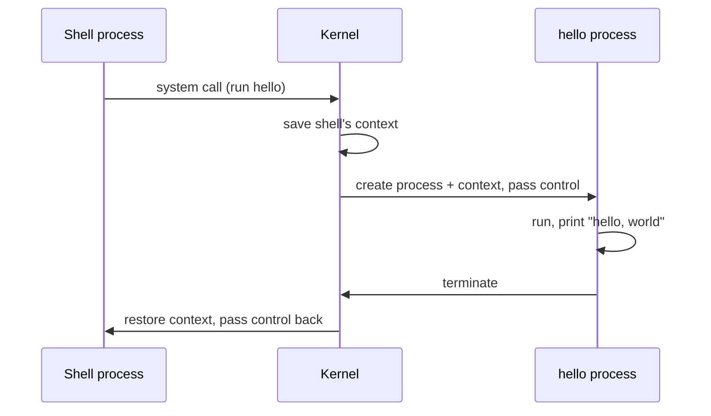

### 1.7.2 Threads

- A process can contain multiple **[[thread]]**s — execution units that share the same code and global data.
- Threads are attractive because: (a) network servers need concurrency, (b) sharing data across threads is easier than across processes, (c) threads are typically cheaper than full processes, and (d) they let a single program exploit multiple CPU cores.

### 1.7.3 Virtual Memory

- **[[virtual memory]]** gives every process the illusion of exclusive access to main memory via its own **virtual address space**.
- Linux layout, from lowest to highest address:

**Diagram — Linux process virtual address space (low → high):**

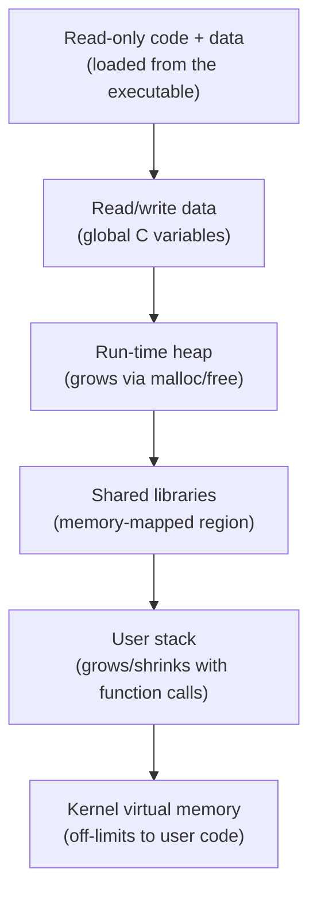

_(Arrows here just show reading order low→high; addresses genuinely increase from bottom to top of the space.)_

- Mechanism: virtual memory contents actually live on **disk**; main memory acts as a **cache for disk**, translated in hardware on every memory access.

### 1.7.4 Files

- A **[[file]]** is nothing more than a sequence of bytes. Every I/O device — disks, keyboards, displays, even networks — is modeled as a file.
- This gives a single **uniform interface** (Unix I/O) for wildly different hardware, and lets the same program run unmodified across different disk/device technologies.

---

## 1.8 Systems Communicate with Other Systems Using Networks

- From a single system's point of view, a **network** is architecturally just another I/O device: bytes copied to the network adapter travel to another machine instead of to local disk.
- Classic illustration: running `hello` remotely via `telnet`.

**Diagram — running `hello` remotely over telnet:**

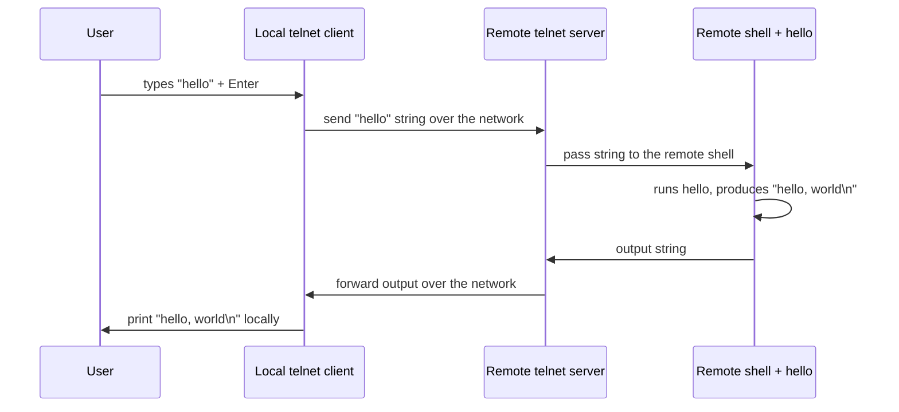

- This client/server request-response pattern is the template for all network applications (email, web, FTP, etc.) — expanded in Ch.11 (building a simple web server).

---

## 1.9 Important Themes

### 1.9.1 Amdahl's Law

If a fraction **α** of total time `T_old` is sped up by a factor **k**, the new time is:

```
T_new = T_old · [(1 − α) + α/k]
Speedup S = T_old / T_new = 1 / [(1 − α) + α/k]
```

- Worked example: speeding up a part that's 60% of the time (α=0.6) by 3× (k=3) → `S = 1/(0.4 + 0.2) = 1.67×` — a much smaller win than the 3× improvement to that one part.
- Limiting case, **k → ∞** (that part becomes instantaneous): `S∞ = 1/(1 − α)`. Even eliminating 60% of the time entirely only yields `1/0.4 = 2.5×` overall.
- **Big-picture lesson:** to meaningfully speed up an entire system, you must improve a _large fraction_ of it — not just optimize one hot spot.
- Applies far beyond computing (the book frames it via a truck-driving-speed example) — any process made of parts, where only some parts get faster.

**🧪 Try it — verify the worked example and the two practice problems:**

- Language: **C** · Compiler: **x86-64 gcc** (or any) · Flags: `-O0 -m64` (no special flags needed — this is pure arithmetic, useful for checking the asm gcc generates for simple floating-point division too)

```c
#include <stdio.h>

double amdahl_speedup(double alpha, double k) {
    return 1.0 / ((1.0 - alpha) + alpha / k);
}

int main(void) {
    // Worked example in the text: alpha = 0.6, k = 3
    printf("Worked example  (alpha=0.6, k=3):   %.3fx\n", amdahl_speedup(0.6, 3.0));

    // Practice Problem 1.1a: Montana speed limit removed, alpha=0.6, k=1.5
    printf("Problem 1.1a    (alpha=0.6, k=1.5): %.3fx\n", amdahl_speedup(0.6, 1.5));

    // Practice Problem 1.2: solve for k given target S=4, alpha=0.9
    double S = 4.0, alpha = 0.9;
    double k = alpha / (1.0 / S - (1.0 - alpha));
    printf("Problem 1.2 solved k: %.3f\n", k);

    return 0;
}
```

> Expected: ~1.667×, ~1.25×, and k ≈ 6.0 — matching the chapter's worked answers (Montana leg driven at 300 km/hr gives the 1.67× target speedup).

### 1.9.2 Concurrency and Parallelism

- **[[concurrency]]** = a system with multiple simultaneous activities. **[[parallelism]]** = _exploiting_ concurrency to make something run faster. Parallelism shows up at three levels:

**a) Thread-level concurrency**

- **Uniprocessor**: concurrency is _simulated_ by rapidly switching between processes/threads (time-sharing).
- **Multiprocessor**: genuinely simultaneous execution, under one OS kernel.

**Diagram — processor taxonomy:**

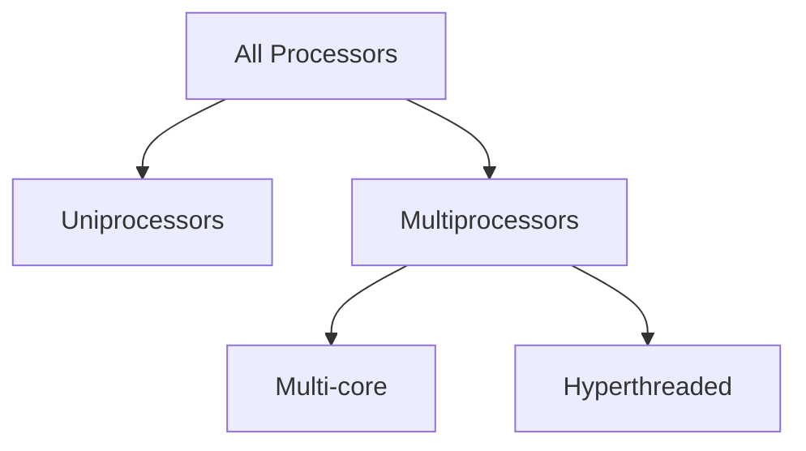

- **Multi-core**: several CPU cores on one chip, each with private L1/L2 cache, sharing a higher-level cache and the memory interface.
- **[[hyperthreading]]** (simultaneous multi-threading): one physical core duplicates _some_ hardware (PC, register file) but not all of it (e.g. floating-point units), letting it switch between threads on a cycle-by-cycle basis rather than the ~20,000-cycle cost of a full context switch.

**Diagram — multi-core processor organization:**

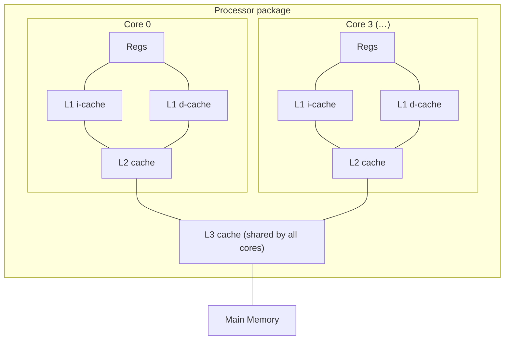

**b) Instruction-level parallelism (ILP)**

- Modern processors can be **superscalar**: sustaining 2–4 instructions/cycle even though any single instruction takes ~20+ cycles start-to-finish, via **pipelining** (splitting instruction execution into overlapping stages).

**c) Single-Instruction, Multiple-Data (SIMD) parallelism**

- One instruction triggers multiple parallel operations — e.g. adding 8 pairs of floats at once. Mostly used to accelerate image/audio/video workloads. Compilers can sometimes auto-vectorize ordinary loops.

**🧪 Try it — auto-vectorized SIMD add:**

- Language: **C** · Compiler: **x86-64 gcc** · Flags: `-O3 -mavx2`

```c
void add_arrays(float *a, float *b, float *c, int n) {
    for (int i = 0; i < n; i++) {
        c[i] = a[i] + b[i];
    }
}
```

> In the Compiler Explorer output, look for a `vaddps` instruction (packed single-precision add) — that's the compiler folding the loop into SIMD operations instead of one `addss` per element. Try dropping to `-O0` to see the scalar (one-element-at-a-time) version for comparison.

### 1.9.3 The Importance of Abstractions in Computer Systems

- Abstractions let programmers use functionality (an API, an OS service) without knowing its internals.
- OS-side abstractions recap: **files** (→ I/O devices), **virtual memory** (→ RAM + disk), **processes** (→ CPU + memory + I/O) — plus a fourth: the **virtual machine**, abstracting the _entire_ computer (OS + processor + programs), useful for running software built for different OSes on one machine.
- Processor-side abstraction: the **[[instruction set architecture]]** hides the real, much more complex **[[microarchitecture]]**, so different physical implementations can run identical machine code.

**Diagram — abstraction layers:**

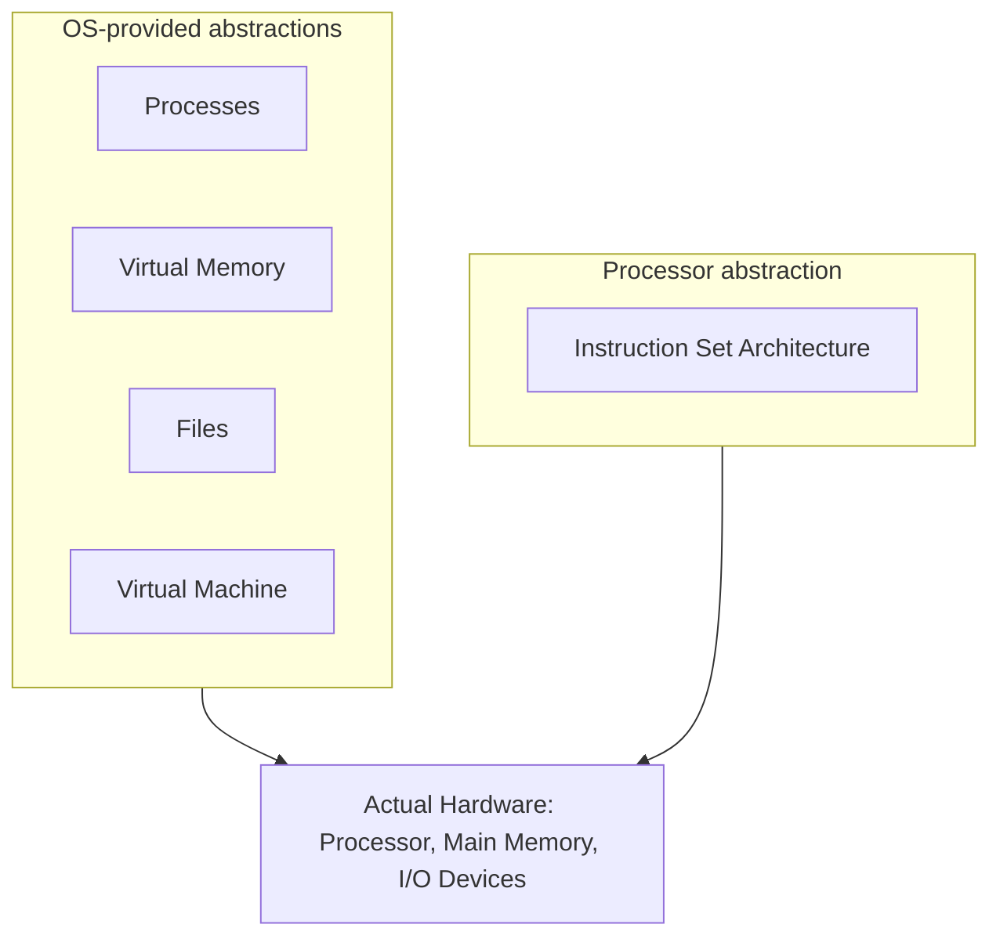

---

## 1.10 Summary

- A system = hardware + systems software; information is bits interpreted via context.
- Programs go text → binary through preprocess/compile/assemble/link.
- Processors execute binary instructions from memory; the **memory hierarchy** (registers → caches → DRAM → disk) exists because storage devices trade off speed vs. capacity/cost, and higher levels cache lower ones.
- The OS kernel mediates between apps and hardware via **files**, **virtual memory**, and **processes**.
- Networks are just another I/O device from a single system's perspective.

## Bibliographic Notes

- Further reading pointers in the original text cover firsthand accounts of early C/Unix history, a Unix-flavors survey, and the GNU/Linux/Posix project sites — worth a skim if the [[Unix]] and [[GNU project]] history is interesting, but not essential to the technical content above.

---

> [!nav] [[cs-hub|Computer Science]]
> [!nav]
> [[cs-hub|Computer Science]]
